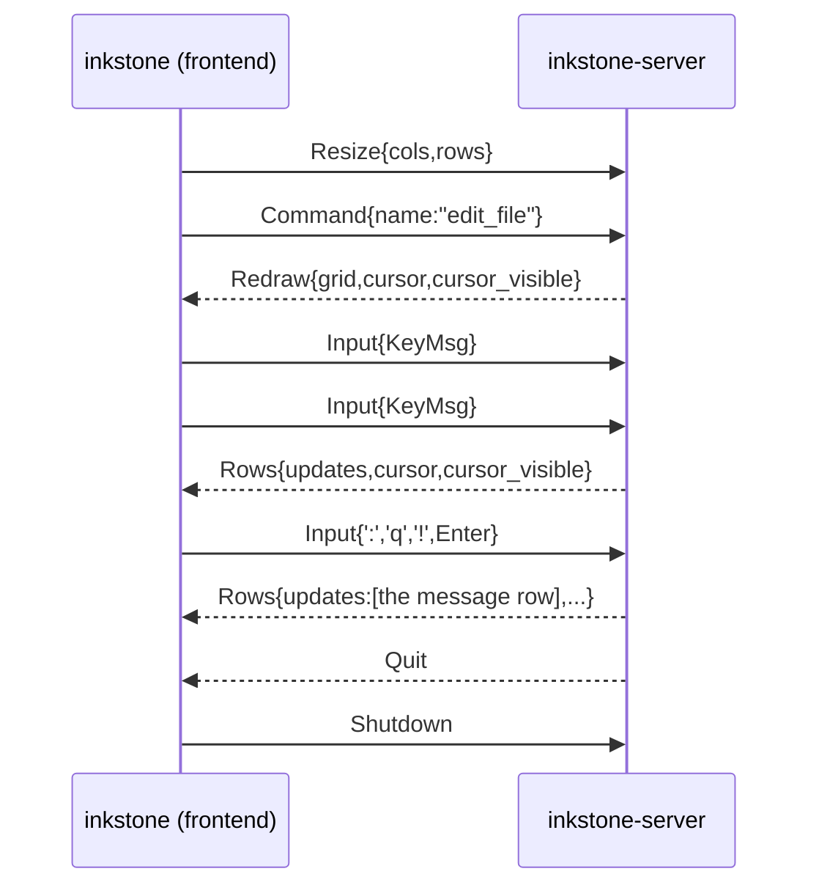

# Architecture

What crosses each boundary in `inkstone`, and the invariants that hold on the other
side of it. Everything here is enforced by tests; the point of writing it down
is that a new feature has to respect these, not rediscover them.

> Working on the code? Start with [`AGENTS.md`](AGENTS.md) (commands, rules,
> what CI cannot check) and [`docs/roadmap.md`](docs/roadmap.md) (what is next,
> and the constraints it inherits from here).

## Where the code lives

The shape of a module is not an accident, and the two rules that decided it are
worth keeping:

- **The interface is what another crate can see.** `inkstone-core` re-exports
  the names the daemon and the frontends use and nothing else; everything else is
  `pub(crate)`, which is what makes an internal rearrangement stop being a
  breaking change. `Editor` has around a dozen fields a frontend reads and a few
  dozen methods it calls; the other five hundred items belong to the crate.
- **A file is not a module, and a big type may be several files.** Rust lets
  `impl` blocks for one type live in any file of the crate, so a concern per file
  costs nothing at run time and nothing in the API.

| Where | What |
|---|---|
| `inkstone-core/src/editor/mod.rs` | the `Editor`, its state, its windows and lists, the constructor |
| `inkstone-core/src/editor/keys.rs` | normal, visual and operator-pending keys |
| `inkstone-core/src/editor/insert.rs` | insert mode |
| `inkstone-core/src/editor/edits.rs` | `replace_range`, registers, undo, indent, case, joins |
| `inkstone-core/src/editor/ex.rs` | the `:` line: parsing, the command table, `:g`, `:s`, `:vimgrep` |
| `inkstone-core/src/editor/prompt.rs` | the command line and the search preview |
| `inkstone-core/src/editor/folds.rs` | folds, views, indent folding |
| `inkstone-core/src/editor/pointer.rs` | the mouse, clicks, separators, scrolling |
| `inkstone-core/src/editor/lists.rs` | the places/history/settings/diagnostics lists |
| `inkstone-core/src/editor/lsp.rs` | completion, snippets, diagnostics, the questions asked |
| `inkstone-core/src/editor/windows.rs` | windows, tabs, documents, the status line |
| `inkstone-core/src/editor/visual.rs` | what a selection covers |
| `inkstone-core/src/editor/tests/` | the kernel's tests, one file per topic |
| `inkstone-server/src/lib.rs` | one `ClientMsg` in, one `ServerMsg` out; the LSP child process |

## Processes and threads

`inkstone` (frontend) spawns `inkstone-server` (daemon) as a child and talks to it over
the child's stdin/stdout. There is exactly one writer to each direction.

| process | thread | owns |
| --- | --- | --- |
| `inkstone` | main | the terminal, the draw loop, the screen cache, the daemon handle |
| `inkstone` | `inkstone-input-reader` | blocking `event::read()` |
| `inkstone` | `inkstone-rpc-reader` | reading frames from the daemon |
| `inkstone-gui` | main | the window, the event loop, the screen cache, the GPU |
| `inkstone-gui` | `inkstone-rpc-reader` | reading frames from the daemon |
| `inkstone-gui` | `inkstone-gui-bridge` | waking the event loop for the frames that arrive |
| `inkstone-server` | main | the `Editor`, the output stream, the Lua VM |
| `inkstone-server` | `inkstone-server-rpc-reader` | blocking read of client frames |

The editor never crosses a thread boundary, so it needs no locks. The only
shared state is messages in a `crossbeam-channel`. Starting the daemon, framing
at it and reading its frames is [`inkstone_client`](crates/inkstone-client), so a
frontend only supplies a window or a terminal and a set of keys.

## The wire

Frames are `u32` big-endian length + MessagePack payload, capped at 64 MiB
(`inkstone_rpc::MAX_FRAME_LEN`). The protocol is notification-only: no request ids,
no replies. A clean EOF (zero bytes of a header) means the peer is gone.

The payload is MessagePack's *compact* form, and a colour travels as one integer
rather than as an enum variant: a screen is two thousand tiny structs, and their
field and variant names are the difference between 63 KiB and 11 KiB per screen.
[`docs/rendering.md`](docs/rendering.md) has the numbers.

A session sends the whole screen once (`ServerMsg::Redraw`, also after a resize,
since a delta needs a screen of the same shape to patch) and then only the rows
that changed (`ServerMsg::Rows`), each as runs of identical cells. A keystroke
that changes nothing but the cursor carries no rows at all. Deltas are only valid
against the frame before them, so a frontend must fold every frame it reads —
that is what [`inkstone_rpc::Screen`] is, and it is the one piece of state a
frontend keeps.

The daemon emits one frame per client message that could have changed the
screen (`Editor::redraw`), plus one before it starts reading, so a frontend
that only reads still sees a screen. `ClientMsg::Input` is a *key*, never a
character: mode logic lives in the daemon. `ClientMsg::Pointer` is a *screen
cell*, never a buffer position, for the same reason: only the daemon knows the
gutter, the tabstops and the wide graphemes that turn a cell into a place in the
document.

`Grid`/`Cell`/`Color` are defined once, in `inkstone-rpc`. `inkstone-core` re-exports
them; it does not define its own.

## The screen model

A `Grid` is `width * height` cells, row-major, and it is always fully
populated — empty screen space is a cell containing `" "`. That makes a grid
self-describing: a frontend writes every cell and never has to clear first.

Every frame also says where the cursor is, whether to show it, and whether the
editor is inserting text. A windowed frontend needs the last one: an input method
belongs where text goes, and left on in normal mode it takes the keys that run
commands. The cursor is a bar while inserting and a block otherwise.

The one piece of state a frontend keeps is `inkstone_rpc::Screen`: the grid the
daemon has drawn, folded forward from the frames it reads, plus the cursor. It
is a cache of the *screen* — a frontend still cannot compute a cursor position,
find a line or run a key.

A cell's colour is the syntax colour where there is one, and its attribute bits
carry everything that composes on top of it: a search match is underlined, the
match the cursor is in is bold, a visual selection is reversed. Four things make
one cell, and they compose rather than replace each other, which is why the row's
styles resolve in one place (`render::RowHighlight`).

A cell whose `text` is **empty** is a *continuation cell*: the second half of a
double-width grapheme stored in the cell to its left. Frontends must skip those
when drawing, or they will blank the right half of every CJK character. Such a
cell carries its grapheme's colours and attributes, so a highlight over a wide
character covers both halves of it.

Row layout is fixed: `height - 2` text rows, then the status line (reverse
video, edge to edge), then the command/message line.

The cursor's screen column comes out of the same walk that draws the line
(`render::draw_line` returns it), so tabs and double-width graphemes cannot
leave the cursor on the wrong cell.

## The line model

`Buffer` text always ends with `'\n'`. An empty buffer is one empty line.

A line is **content plus its terminator**, and the terminator is not part of the
content: `Buffer::line` strips it, `Buffer::line_terminator` returns it. That is
what makes `$`, `A`, `o` and `dd` behave on a CRLF file, and it means
`Buffer::text` still returns the original bytes — opening and saving never
rewrites line endings.

The set of terminators is the one the rope recognises (LF, CRLF, CR, VT, FF,
NEL, LS, PS), so the two models can never disagree about how many lines a
buffer has.

## The cursor

`col` is an *insertion point*: `0..=line_len(row)`, where `line_len` excludes
the terminator. A column of `line_len(row)` means "just past the last
character", which is where insert mode belongs.

Normal mode does not belong there. `Editor::clamp_normal_cursor` keeps the
cursor on a real character whenever the mode is normal, which is what makes
`x`, `$` and `l` behave at the end of a line. It runs before dispatching a
normal-mode key and after every edit.

## Documents and windows

The editor has one or more files open, and one or more windows looking at them.
A `Document` is a buffer and what follows it through a file — the undo history,
the search and its matches, the syntax colours and the per-line state they need.
A `Window` is a *look* at a document: which document, where the cursor is in it,
and where it is scrolled to. Everything else — the register, the mode, the
keymap, the options, the command line, the script host — belongs to the session
and is shared. Design notes: `docs/buffers.md`, `docs/windows.md`.

The window that is up and its document keep their state in the editor's own
fields; every other one keeps its state in its slot, and switching swaps the two.
That is why `:bn` and `<C-w>j` need nothing from the rest of the editor: a
command reading `self.cursor` was already reading the cursor of the window that
is up, and one reading `self.buffer` the document it shows.

Two seams are worth knowing. The screen's size lives in the viewport but belongs
to the screen, not to the window that happened to be up when it was resized, so
only the scroll is saved and loaded. And a window may look at a document that is
live in the editor's fields, in which case its slot holds a placeholder: the
renderer reads the text of those windows from the view itself and only their
positions from the windows.

## The edit history

One step is one *replacement*: `[start, start + removed.len())` held `removed`
and now holds `inserted`, plus the cursor on either side of it. A step stores
character indices and owned text — never a rope slice, never a snapshot — so it
stays valid while later steps are recorded on top of it, and undoing
newest-first always restores the buffer to the exact state the next step down
was made in.

Every step's result is a *state* with an identity the history hands out, and the
last write remembers which state it wrote. That is the whole of "modified": no
flag on the buffer, no comparing text, and `u` back to the written state clears
the marker while `u` past it puts the marker back. An edit that restores the same
text is still an edit — it is a different state.

Three things make that exact:

- **`Buffer::replace_range` is the only mutation.** A step is rebuilt with one
  replacement, and the trailing-newline invariant is restored once, at the end
  of it. Two operations would repair the newline in between, and a `dd` on the
  last line of a file would come back with an extra empty line.
- **A step that removes the buffer's last terminator owns the newline the
  invariant hands back** (`Change::planned`). `remove(0, len)` on `"abc\n"`
  leaves `"\n"`, so the step is "`abc\n` became `\n`" — and undo and redo are
  exact because the newline is part of it.
- **A group is what a user thinks a change is.** A group is opened around one
  command and around an insert session, and *when it closes* the steps inside it
  are folded into one — which is what makes `ohello<Esc>` a single `u`, even
  though the line break and the typing are two steps that never chain. While it
  is open, a step that continues the group's entry (writing where the caret is,
  backspacing in front of it, deleting a run one key at a time) grows that entry
  instead. A step also remembers where its caret sits inside what it wrote,
  since `o` leaves the cursor in front of the line break it inserted rather than
  after it. Folding gives up rather than guessing when two steps in a group
  overlap (`docs/undo.md` says what that costs). That is why
  `Editor::run_command` opens one: `3x` is one command and so one `u`, and
  `i…<Esc>` is one session and so one `u`.

Nothing about this is on the wire: a frontend sends `u` as a key, or `undo` as
a command, and gets a redraw of the restored screen back.

## Modes

| mode | dispatch |
| --- | --- |
| normal | keymap → command registry, with a pending buffer for multi-key sequences |
| visual | its own keymap first (the operators), then the normal mode's — so a motion is extended by exactly the command `w` is bound to |
| insert | insert-mode keymap first — sequences included, with the keys held back until the next one says whether they are a mapping, and typed after all when they are not — then built-in text entry |
| command | edits a command line, executed on `<Enter>` by `Editor::execute_cmdline` |

A pattern is a Rust regular expression, compiled once and kept, and it is matched
*within a line* — which is what makes `^` and `$` the line's own ends and a match
something a row can draw. `:s` replaces with the same compiled pattern, so search
and substitution cannot disagree about what a pattern means.

`/` and `?` are the same mode as `:`, with a different prompt character, and
`Prompt` is what tells them apart: the editor hands the renderer the whole line
(`:w`, `/two`) rather than a mode for it to spell. That line is a `String` and a
character index — not a `Buffer` — and while it is being typed the terminal
cursor belongs *in* it, which is also where an input method's window should
appear.

A visual selection is an anchor and a kind; the cursor is its other end, so it is
recomputed from the two on every frame instead of being stored as indices that a
later edit would move. The highlight is the reverse-video attribute bit, which is
why visual mode needed nothing on the wire.

A character find (`f`, `F`, `t`, `T`) is a motion made of *two* keys, and the
second one is any character at all — which a keymap cannot hold, since a keymap
is a table from key sequences to command names. So the find is caught in the
three places a key can arrive (normal mode, an operator waiting for its motion,
and a selection) and the character is passed to the command as its parameter.
What the find looked for is remembered on the editor, which is what `;` and `,`
use to look again and what makes `df,` repeatable by `.` — the operator grammar
passes the *motion's name*, so the character has to be somewhere the motion can
find it.

A command is a *change* if it made the buffer different or opened an insert
session: the history counts its edits, and `Editor::run_command` compares the
count around the call. That one fact is what `.` repeats, together with the keys
an insert session typed — recorded as text as it is typed, with a backspace and a
delete as tokens of their own, because replaying the keys is the only way
`iab<BS>c<Esc>` repeats as `ac`. Motions, yanks, searches and `u` are not
changes, so none of them disturbs the memory.

An operator (`d`, `y`, `c`) is a pending state of the normal mode, and what
finishes it is either a motion — looked up in the keymap, so a remapped `w` takes
`dw` with it — or a text object, which is `i` or `a` followed by the key that
names one. The object answers with a range directly — a range of characters, or
of whole lines with their terminators, since a paragraph is lines — and
everything after that is the same `cut`, `copy` and insert-mode entry the motions
use. A linewise object also makes the *selection* linewise: the last character of
a line is its terminator, and a normal-mode cursor cannot sit on one, so a
linewise range has lines at its ends rather than characters. `E348: No string under cursor` is `*` with no
word to search for.

A command is `fn(&mut Editor, &[Param]) -> Result<()>` in a flat registry
(`CommandRegistry`), addressable by name, with a numeric first parameter treated
as a repeat count. Commands cannot capture state, which is what lets a script
layer enumerate and call them.

Dispatch order for a name: built-in registry → Lua command → `E492`.

## Lua

Scripts reach the editor through one global, `ed`. They cannot borrow it: the
editor owns the Lua VM, so a callback borrowing the editor would alias. Instead
`ed.run(...)` **queues** the call and `Editor::run_command` drains the queue
after the Lua call returns, bounded by `MAX_COMMAND_DEPTH` (100).

`init.lua` is sourced once at startup. A failure is reported on the status line
and ignored — a config typo must not stop the editor from opening.

## Messages a user can see

| text | when |
| --- | --- |
| `E32: No file name` | writing a buffer that has no path |
| `E13: File exists (add ! to override): X` | a `:w` where the file on disk is not the one this buffer read: a name that is already there, or a file somebody else has written since |
| `E37: No write since last change (add ! to override)` | `:q` (including the `:q` that closes one window), `:e` or `:bd` with unsaved changes |
| `E21: Cannot make changes, 'readonly' option is set` | an edit while a list window is up — a `:copen` list, `:set all`, `q:`, `q/`: a list is not for editing |
| `E492: Not a command: X` | unknown name on the `:` line, or from `ed.run` |
| `E5108: command nesting too deep` | runaway Lua command recursion |
| `unmapped key: X` | normal-mode key with no binding |
| `X is not a motion` | a key followed `d`, `y` or `c` that takes no range |
| `E354: Invalid register name: X` | a `"` followed by something that is not a register |
| `E486: Pattern not found: X` | a search, or `n`, with no match left to find |
| `E35: No previous search pattern` | `/` or `n` before anything was searched for |
| `E54: …` | a pattern that does not compile, or that asks for what the dialect cannot do: `\zs` inside a collection, a marker followed by a multi; the engine's own explanation follows |
| `E348: No string under cursor` | `*` or `#` with no word under the cursor |
| `E85: There is no other buffer` | `:bn` or `:bp` with one document open |
| `E85: There is no other window` | a `<C-w>` key with one window |
| `E85: There is no line to join` | `J` on the last line of the file |
| `E16: Invalid range` | `<C-w>h` `j` `k` `l` with no window that way |
| `E36: Not enough room` | a resize with nothing to take from the other window |
| `E94: No matching buffer for X` | `:b` with a name nothing is called |
| `E484: No file name under the cursor` / `E484: Can't open file X` | `gf` with no name under the cursor, or on a name that is not there |
| `E471: Argument required` | a command that needs one — `:s`, `:b`, `:delmarks`, `:set_diagnostics` — with nothing after it |
| `E474: Invalid argument: X` | an argument a command cannot read: a `:delmarks` letter, a `:sort` flag, a `:set` outside its spellings, an `:mkview` with no file name |
| `E475: Invalid argument: X` / `E475: Invalid diagnostic: X` | `:resize` with something that is not a number / a `set_diagnostics` entry that does not parse |
| `E488: Trailing characters: X` | a `:s` flag that is not `g` or `i`, or a delimiter that is not one |
| `E518: Unknown option: X` | `:set` with a name no setting has |
| `E33: No previous substitute regular expression` | `:&` or `:&&` before any `:s` |
| `E490: No fold found` | `zx` with `'foldmethod'` not set to `indent` |
| `E748: No previous macro` / `E748: No such macro: X` | `@@` before any `@a` / `@a` naming a register nothing was recorded into |
| `E776: No command history` / `E776: No search history` | `q:` or `q/` with nothing in it |
| `E776: No location list` / `E553: No more items` | `:colder` or `:cnewer` with no list yet / past either end of them |
| `E683: File name missing or invalid pattern` | a `:vimgrep` with no pattern, or with no files to look in |
| `E481: No range allowed` | `:1,5vimgrep`: the number in front of the command is a count of places to find, and a comma would mean a range |
| `E480: No match: X` | a `:vimgrep` that found nothing in any of its files; the list is emptied |
| `fuzzy matching is not implemented` | the `f` flag of `:vimgrep` |
| `N matches in M files` | a `:vimgrep` with `j`: the list is filled and the cursor stays put |
| `{index} of {count}: {path}` | going to a place in a list: `:cnext`, `<CR>` in a list window, or the first place a `:vimgrep` found |
| `E784: Cannot close last tab page` | `:tabclose` with one tab |
| `E20: Mark not set: X` | a jump to a place nothing was set or left: a mark, `''`, or `<C-o>`/`<C-i>` at either end of the jump list |
| `E20: No previous visual selection` / `E20: No previous insert position` | `gv` / `gi` with nothing to go back to |
| `E20: no older change` / `E20: no newer change` | `g;` / `g,` at either end of the change list |
| `N substitutions on M lines` | a `:s` that worked, and how much it changed |
| nothing at all | a copy with an empty register: there is nothing to send |
| `Already at oldest change` | `u` with nothing left to undo |
| `Already at newest change` | `<C-r>` with nothing to redo |
| `init.lua: ...` | the config failed to load |
| `"path" written` / `"name"` | a successful write / a freshly opened file |

Every `E` code the kernel can show is here, along with the messages a person
sees that carry no code at all.

A message survives until the next key pressed *outside* command mode, so the
key that runs a `:` command does not erase what it just reported.

## What a change costs

The recurring shapes — keys, cell attributes, settings, commands — are declared
once, in a macro, and everything else is generated from that declaration:
`key_codes!` (`inkstone-rpc`) emits the enum, `ALL` and the spelling table;
`cell_attributes!` emits the constants and `ATTRS`; `settings!` and `commands!`
(`inkstone-core`) emit the setting enum, the options struct, its defaults and the
`set`/`get` pair, and the command registry. There is no second list to keep in
step, which is what makes a forgotten case a build error instead of a runtime
surprise.

| change | files touched | what catches a miss |
| --- | --- | --- |
| new command | write the handler in `command.rs`, add its name to the `commands!` list, optionally a default key + a README row | a name with no function is a build error; the README test |
| new motion | `cursor.rs` (pure) + one thin command | compiler |
| new setting | one line in the `settings!` table (plus a `SettingValue` impl for a new type) | nothing else to touch; the generated test round-trips it |
| new key | one line in the `key_codes!` table | the frontend's mapping test fails to compile until it is mapped |
| new cell attribute | one line in `cell_attributes!`, then `render.rs` and `inkstone/src/main.rs` | the frontend attribute test |
| new message | `inkstone-rpc`, `inkstone-server` (`Session::handle`), `inkstone` (frontend match) | exhaustive matches |
| new mode (e.g. visual) | `mode.rs`, `editor.rs` (dispatch), `command.rs`, `keymap.rs`, `lua.rs` (name), `render.rs` (display) | exhaustive matches on `Mode` |
| new frontend | nothing existing | — (that is the point of the split) |

A new mode touching six files is not a design failure: a mode *is* a key
handler, a set of commands, a thing scripts can name and a thing to draw. What
matters is that each touch is one match arm, and that three of the six are
compiler-enforced.

## Adding things

- **A new command**: write `fn name(editor: &mut Editor, params: &[Param])` in
  `command.rs` and add `name` to the `commands!` list. The name is not repeated
  anywhere, so it cannot be registered under the wrong one. Bind it in
  `Keymap::with_defaults` if it deserves a default key, and add a row to the
  README's keymap table (a test compares that table to the built-in keymap).
- **A new motion**: implement the movement on `Cursor` (pure, buffer in,
  position out), then a command that calls it and ends with `after_edit()`,
  which re-clamps the cursor, scrolls it into view and marks the screen dirty.
- **A new setting**: add one line to the `settings!` table in `settings.rs`.
  The enum, the struct, the default, the name lookup and `set`/`get` all follow
  from it. A new *type* of value needs a `SettingValue` impl saying how it maps
  to and from `Param`.
- **A new key**: add one line to the `key_codes!` table in `inkstone-rpc`. The
  notation layer needs nothing; the frontend is forced to map it, because the
  test that iterates `KeyCode::ALL` matches over the enum exhaustively.
- **A new cell attribute**: add one line to `cell_attributes!`, then teach
  `render.rs` to emit it and the frontend to translate it — the attribute test
  fails until both do.
- **A new message**: add it to `ClientMsg`/`ServerMsg`, handle it in
  `Session::handle`. Frontends are free to ignore anything they do not know.
- **A new frontend**: use [`inkstone-client`](crates/inkstone-client) to start the
  daemon and read its frames, fold them into an `inkstone_rpc::Screen`, draw the
  rows it hands you, and turn your window's or terminal's events into `KeyMsg`s
  (and `ClientMsg::Text` for anything that was never a key). Nothing else is
  required — that is the whole contract.
  [`docs/rendering.md`](docs/rendering.md) is what a second frontend needs
  beyond it, and what a screen costs on the wire.

## Deliberate limitations

- A brand-new empty file is written as one byte (`"\n"`), which is stable on
  reload but differs from vim's zero bytes.
