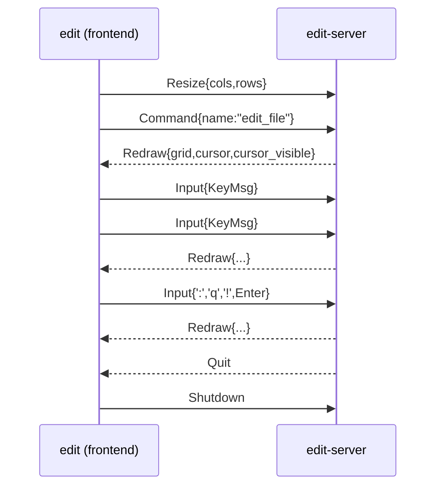

# Architecture

What crosses each boundary in `edit`, and the invariants that hold on the other
side of it. Everything here is enforced by tests; the point of writing it down
is that a new feature has to respect these, not rediscover them.

## Processes and threads

`edit` (frontend) spawns `edit-server` (daemon) as a child and talks to it over
the child's stdin/stdout. There is exactly one writer to each direction.

| process | thread | owns |
| --- | --- | --- |
| `edit` | main | the terminal, the draw loop, the child handles |
| `edit` | `edit-input-reader` | blocking `event::read()` |
| `edit` | `edit-rpc-reader` | reading frames from the daemon |
| `edit-server` | main | the `Editor`, the output stream, the Lua VM |
| `edit-server` | `edit-server-rpc-reader` | blocking read of client frames |

The editor never crosses a thread boundary, so it needs no locks. The only
shared state is messages in a `crossbeam-channel`.

## The wire

Frames are `u32` big-endian length + MessagePack payload, capped at 64 MiB
(`edit_rpc::MAX_FRAME_LEN`). Milestone 1 is notification-only: no request ids,
no replies. A clean EOF (zero bytes of a header) means the peer is gone.

The daemon emits one frame per client message that could have changed the
screen (`Editor::redraw`), plus one before it starts reading, so a frontend
that only reads still sees a screen. `ClientMsg::Input` is a *key*, never a
character: mode logic lives in the daemon.

`Grid`/`Cell`/`Color` are defined once, in `edit-rpc`. `edit-core` re-exports
them; it does not define its own.

## The screen model

A `Grid` is `width * height` cells, row-major, and it is always fully
populated — empty screen space is a cell containing `" "`. That makes a grid
self-describing: a frontend writes every cell and never has to clear first.

A cell whose `text` is **empty** is a *continuation cell*: the second half of a
double-width grapheme stored in the cell to its left. Frontends must skip those
when drawing, or they will blank the right half of every CJK character.

Row layout is fixed: `height - 2` text rows, then the status line (reverse
video, edge to edge), then the command/message line.

The cursor's screen column comes out of the same walk that draws the line
(`render::draw_line` returns it), so tabs and double-width graphemes cannot
leave the cursor on the wrong cell.

## The line model

`Buffer` text always ends with `'\n'`. An empty buffer is one empty line.

A line is **content plus its terminator**, and the terminator is not part of the
content: `Buffer::line` strips it, `Buffer::line_terminator` returns it. That is
what makes `$`, `A`, `o` and `dd` behave on a CRLF file, and it means
`Buffer::text` still returns the original bytes — opening and saving never
rewrites line endings.

The set of terminators is the one the rope recognises (LF, CRLF, CR, VT, FF,
NEL, LS, PS), so the two models can never disagree about how many lines a
buffer has.

## The cursor

`col` is an *insertion point*: `0..=line_len(row)`, where `line_len` excludes
the terminator. A column of `line_len(row)` means "just past the last
character", which is where insert mode belongs.

Normal mode does not belong there. `Editor::clamp_normal_cursor` keeps the
cursor on a real character whenever the mode is normal, which is what makes
`x`, `$` and `l` behave at the end of a line. It runs before dispatching a
normal-mode key and after every edit.

## Modes

| mode | dispatch |
| --- | --- |
| normal | keymap → command registry, with a pending buffer for multi-key sequences |
| insert | insert-mode keymap first, then built-in text entry; mappings are single-key |
| command | edits a command line, executed on `<Enter>` by `Editor::execute_cmdline` |

A command is `fn(&mut Editor, &[Param]) -> Result<()>` in a flat registry
(`CommandRegistry`), addressable by name, with a numeric first parameter treated
as a repeat count. Commands cannot capture state, which is what lets a script
layer enumerate and call them.

Dispatch order for a name: built-in registry → Lua command → `E492`.

## Lua

Scripts reach the editor through one global, `ed`. They cannot borrow it: the
editor owns the Lua VM, so a callback borrowing the editor would alias. Instead
`ed.run(...)` **queues** the call and `Editor::run_command` drains the queue
after the Lua call returns, bounded by `MAX_COMMAND_DEPTH` (100).

`init.lua` is sourced once at startup. A failure is reported on the status line
and ignored — a config typo must not stop the editor from opening.

## Messages a user can see

| text | when |
| --- | --- |
| `E32: No file name` | writing a buffer that has no path |
| `E37: No write since last change (add ! to override)` | `:q` or `:e` with unsaved changes |
| `E492: Not a command: X` | unknown name on the `:` line, or from `ed.run` |
| `E5108: command nesting too deep` | runaway Lua command recursion |
| `unmapped key: X` | normal-mode key with no binding |
| `init.lua: ...` | the config failed to load |
| `"path" written` / `"name"` | a successful write / a freshly opened file |

A message survives until the next key pressed *outside* command mode, so the
key that runs a `:` command does not erase what it just reported.

## What a change costs

Rust cannot enumerate an enum's variants, so anything that has to be *listed*
is listed by hand and paired with a test that iterates the list. `Setting` does
not need such a list for its setters — the `match`es in `Options::set`/`get`
and `Setting::name` are exhaustive, so forgetting one is a build error. For
`KeyCode::ALL` and `ATTRS` the list *is* the source of truth, and what no test
can catch is a variant that never gets added to it; that is why the list lives
next to the type with a comment saying so, and why the tests that iterate it
exist.

| change | files touched | what catches a miss |
| --- | --- | --- |
| new command | `command.rs`, optionally `keymap.rs` + `README.md` | the README keymap test |
| new motion | `cursor.rs` (pure) + one thin command | compiler |
| new setting | `editor.rs` (`Options` field, `Setting` variant, default) | exhaustive `set`/`get`/`name` matches |
| new key | `edit-rpc` (`KeyCode` + `KeyCode::ALL`), `keymap.rs` (notation), `edit/main.rs` (terminal) | two tests iterate `KeyCode::ALL` |
| new cell attribute | `edit-rpc` (bit + `ATTRS`), `render.rs`, `edit/main.rs` | the frontend attribute test |
| new message | `edit-rpc`, `edit-server` (`Session::handle`), `edit` (frontend match) | exhaustive matches |
| new mode (e.g. visual) | `mode.rs`, `editor.rs` (dispatch), `command.rs`, `keymap.rs`, `lua.rs` (name), `render.rs` (display) | exhaustive matches on `Mode` |
| new frontend | nothing existing | — (that is the point of the split) |

A new mode touching six files is not a design failure: a mode *is* a key
handler, a set of commands, a thing scripts can name and a thing to draw. What
matters is that each touch is one match arm, and that three of the six are
compiler-enforced.

## Adding things

- **A new command**: write the function in `command.rs`, register it in
  `CommandRegistry::with_builtins`, bind it in `Keymap::with_defaults` if it
  deserves a default key, and add a row to the README's keymap table (a test
  compares that table to the built-in keymap).
- **A new motion**: implement the movement on `Cursor` (pure, buffer in,
  position out), then a command that calls it and ends with `after_edit()`,
  which re-clamps the cursor, scrolls it into view and marks the screen dirty.
- **A new setting**: add the field to `Options` with a default, add a
  `Setting` variant, and add it to `Setting::ALL`. The `set`/`get`/`name`
  matches are exhaustive, so a forgotten case stops the build.
- **A new key**: add the `KeyCode` variant *and* add it to `KeyCode::ALL`;
  tests in `edit-core` (notation) and `edit` (terminal mapping) then fail until
  both sides know it.
- **A new cell attribute**: add the bit *and* add it to `ATTRS`; the frontend
  test fails until it translates the bit.
- **A new message**: add it to `ClientMsg`/`ServerMsg`, handle it in
  `Session::handle`. Frontends are free to ignore anything they do not know.
- **A new frontend**: implement the framing, blit `Grid`, forward terminal keys
  as `KeyMsg`. Nothing else is required — that is the whole contract.

## Deliberate limitations

- Sending a redraw per keystroke is fine at this size; there is no diffing.
- Horizontal scroll is measured in characters, not display columns, so a tab in
  the scrolled-off region can leave the view a column off.
- A brand-new empty file is written as one byte (`"\n"`), which is stable on
  reload but differs from vim's zero bytes.
